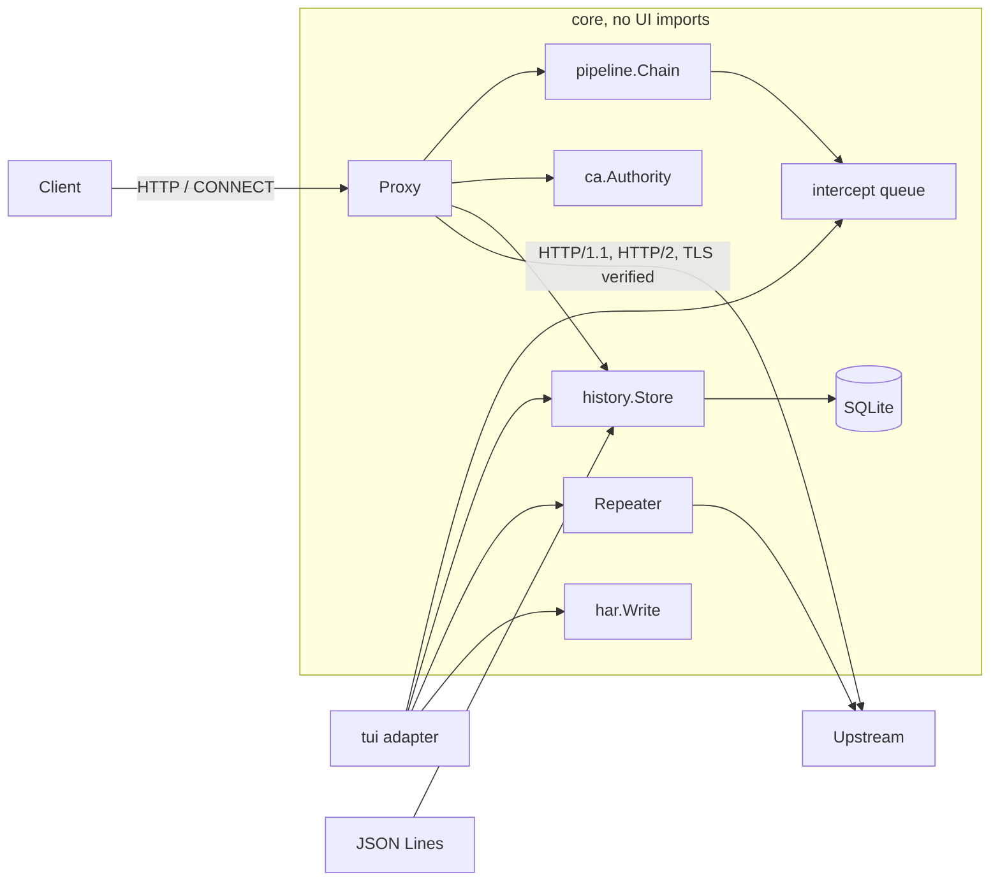

# burpui

An intercepting HTTP/HTTPS proxy with a terminal UI, written in Go. It sits between a client and a server so you can inspect, hold, edit, drop and replay traffic.

> Use it only against systems you own or are explicitly authorized to test.

## Features

- HTTP/1.1 forward proxy and `CONNECT`.
- HTTPS interception (MITM) with a local CA: key persisted with `0600` permissions, per-host leaf certificates minted on demand and cached in an LRU.
- HTTP/2 to the upstream where negotiated; WebSocket upgrades are passed through untouched.
- Upstream TLS verification is **on** by default.
- Interceptor chain plus an intercept queue: hold, edit, forward or drop. Every hold has a timeout, so a held request never blocks the proxy forever.
- History: in-memory ring buffer, optional SQLite persistence (pure Go, `modernc.org/sqlite`), host-glob scope and full-text search.
- Repeater: resend a stored request with edits and see a diff against the original response.
- HAR 1.2 export.
- Headless mode that writes JSON Lines, for scripting.

## Architecture



| Package | Responsibility |
| --- | --- |
| `internal/flow` | Request, response and flow records; raw text codec used for editing |
| `internal/ca` | Root CA, persistence, leaf minting, trust instructions |
| `internal/pipeline` | `Interceptor` interface, `Chain`, `Queue` |
| `internal/proxy` | Listener, forward path, CONNECT, MITM, WebSocket |
| `internal/history` | Ring buffer, scope and search, SQLite persister |
| `internal/repeater` | Resend and response diff |
| `internal/har` | HAR 1.2 writer |
| `internal/tui` | Bubble Tea adapter; holds no business logic |
| `internal/app` | Wiring and headless output |

## Install and run

```sh
go build -o bin/burpui ./cmd/burpui
./bin/burpui --listen 127.0.0.1:8080
```

Or `go run ./cmd/burpui --listen :8080`. On the first run the CA is created under your user config dir and the trust instructions are printed; run `burpui --trust-help` to see them again, or `--export-ca ca.pem` to write the certificate.

```sh
curl --cacert ~/.config/burpui/ca-cert.pem --proxy http://127.0.0.1:8080 https://example.com/
```

Headless, with persistence and a scope:

```sh
burpui --headless --db history.db --scope '*.example.test' > flows.jsonl
```

### Keys

| Key | Action |
| --- | --- |
| `j` / `k`, `g` / `G` | Move in the history list |
| `tab` | Cycle request, response and repeater panes |
| `pgup` / `pgdn` | Scroll the viewer |
| `i` | Toggle intercept |
| `f` / `d` | Forward or drop the oldest held request |
| `e` | Edit the held request, `ctrl+s` forwards it, `esc` cancels |
| `r` | Open the selected request in the repeater, `ctrl+s` sends it |
| `/` | Search URL, headers and bodies |
| `s` | Toggle the scope filter |
| `x` | Export the visible flows as HAR to `./burpui-<time>.har` |
| `?` | Toggle the long help bar |
| `q` | Quit |

### Flags

| Flag | Default | Meaning |
| --- | --- | --- |
| `--listen` | `127.0.0.1:8080` | Proxy address; a warning is logged for non-loopback binds |
| `--headless` | off | No TUI: JSON Lines on stdout, JSON logs on stderr |
| `--mitm` | on | `--mitm=false` tunnels `CONNECT` untouched |
| `--ca-dir` | user config dir | CA location |
| `--trust-help`, `--export-ca` | | Print trust steps / write the certificate, then exit |
| `--scope`, `--exclude` | all | Comma-separated host globs; scope also limits what the intercept queue holds |
| `--hold-timeout` | `60s` | A held request is dropped after this long |
| `--db` | memory only | SQLite file for persistent history |
| `--history-size` | `5000` | Flows kept in memory |
| `--max-body` | 32 MiB | Largest buffered body; larger requests get 413, larger responses 502 |
| `--max-capture` | 4 MiB | Body bytes kept in history per message |
| `--insecure-upstream` | off | Skips upstream TLS verification. Dangerous |
| `--verbose`, `--log-file` | | Debug logs; append logs to a file (the TUI discards logs otherwise) |

Exit codes: `0` success, `1` runtime error, `2` usage error.

## Headless output schema (version 1)

One JSON object per completed flow:

```json
{"schema":1,"id":7,"time":"2026-01-02T03:04:05Z","method":"GET","url":"https://api.test/v1/items","status":200,"proto":"HTTP/2.0","duration_ms":12.5}
```

`error`, `dropped`, `websocket` and `tunnel` appear only when set. `status` is `0` when no response was obtained. New fields may be added without a schema bump; renames or removals bump `schema`.

## Design decisions and trade-offs

- **Bodies are buffered**, not streamed. This is what makes edit, hold and replay possible. The price is memory (bounded by `--max-body`) and no support for server-sent streams that never end.
- **The client side of MITM speaks HTTP/1.1 only.** The upstream side uses HTTP/2 when negotiated. This avoids a second HTTP/2 server stack and is invisible to most clients.
- **Held requests time out and are dropped**, not forwarded: an unattended hold must not release a request you meant to inspect.
- **One shared leaf key** signs every minted certificate; minting is then a single signature, and the cache keeps repeat hosts free.
- **A CONNECT whose first byte is not a TLS handshake is tunnelled blindly**, so non-HTTPS protocols over port 443 keep working.
- **WebSocket frames are not recorded**; the upgrade exchange is, and the stream is piped.
- **Config is flags only**; there is no config file.
- **No automatic CA installation.** The tool prints the commands; you decide where to trust the CA.

## Development

```sh
make test   # go vet + go test -race ./...
make lint   # gofmt + golangci-lint
```

All tests run on loopback against `httptest` servers; none touch the network.

## License

MIT
